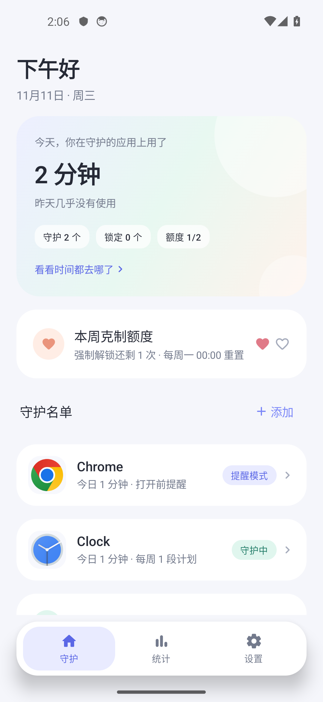
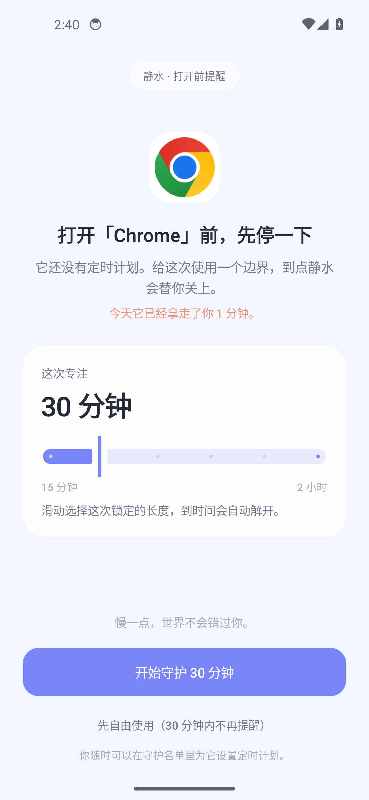
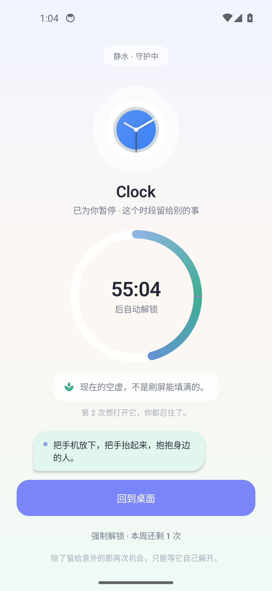
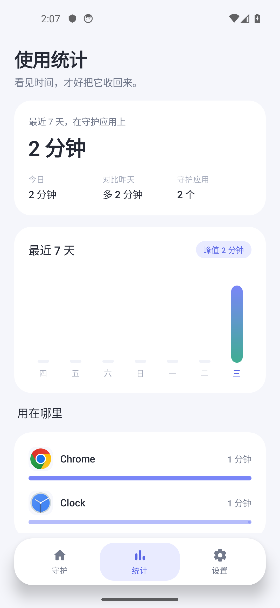
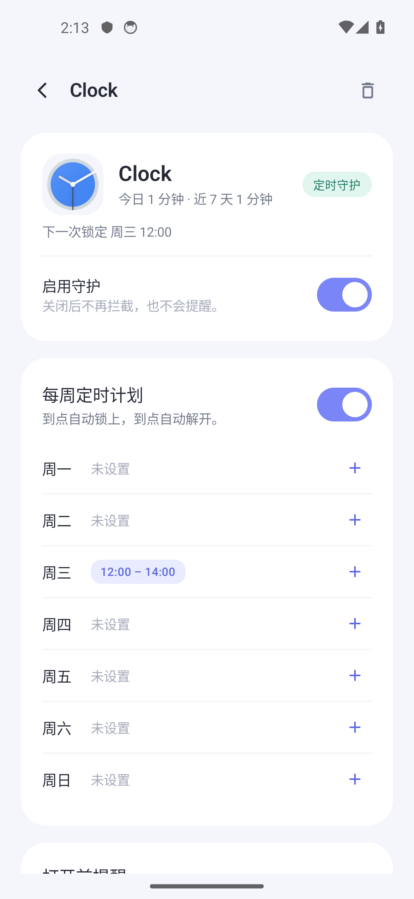
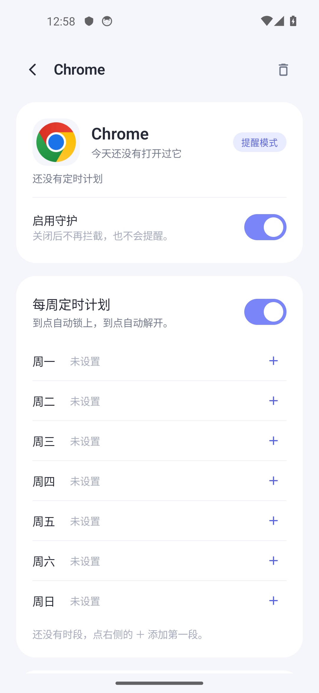
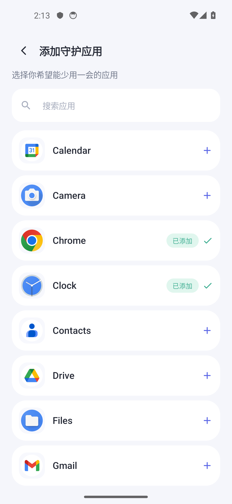
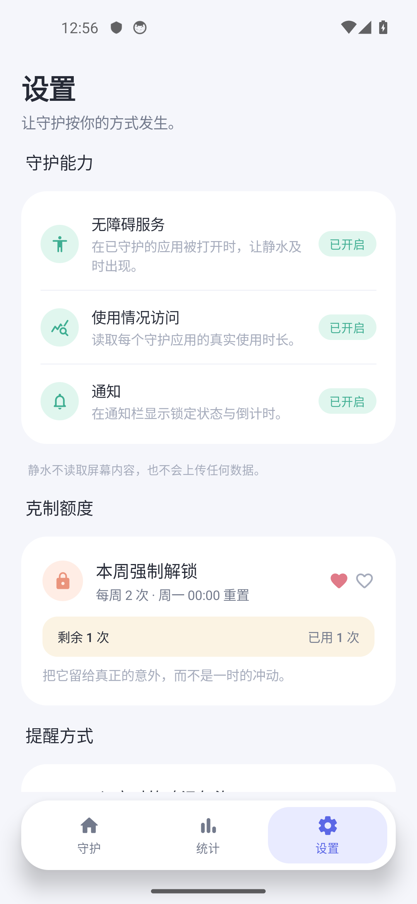

# 静水 · KKDetain

> 把时间还给生活。

静水是一款 Android 端的自控 / 防沉迷应用。它不会替你砸掉手机，只会在你想打开那些「一开就停不下来」的应用时，轻轻挡在中间。

淡色系界面、圆角卡片、柔和的倒计时环，以及在你心痒难耐时飘出来的几句鸡汤——克制不必是苦行。

---

## 下载

安装包见 [Releases · v1.0.0](https://github.com/KongDehang/KStore/releases/tag/v1.0.0)，文件为 `KKDetain-1.0.0.apk`（Android 8.0 及以上，约 11 MB）。

下载后允许「安装未知来源应用」即可安装。该包使用 debug 密钥签名，仅供个人安装体验，不适合上架应用商店。

---

## 功能

| # | 能力 | 说明 |
|---|------|------|
| 1 | 应用守护名单 | 从已安装应用中挑选想减少使用的应用加入名单 |
| 2 | 定时锁定 | 每个应用可单独开启「每周定时计划」 |
| 3 | 按天设置时段 | 周一至周日分别设置一段或多段锁定时段，支持跨夜（如 22:00 – 02:00） |
| 4 | 打开前提醒 | 没有定时计划时，打开应用会先出现提醒页，滑动选择 15 分钟 – 2 小时的专注时长，到点自动解锁 |
| 5 | 无法随意解锁 | 锁定期内只能等待自动解锁；倒计时、剩余时长、拦截理由都写在锁屏页上 |
| 6 | 每周克制额度 | 每周 2 次强制解锁机会，每次消耗 1 次，周一 00:00 重置；确认前需要深呼吸 5 秒 |
| 7 | 使用统计与建议 | 最近 7 天的使用时长、应用排行、拦截次数，以及每天轮换的小建议 |
| 8 | 鸡汤气泡 | 反复尝试打开被锁应用时，屏幕上会飘出鼓励气泡；返回键也会触发一句 |
| 9 | 审美在线 | 淡紫 / 薄荷 / 蜜桃的柔和配色，大圆角、低对比、克制的动效 |

补充细节：

- 锁定时段结束后自动解锁；跨夜时段从当天开始一直持续到第二天结束时间。
- 时间选择支持「开始 = 结束」表示锁定全天。
- 多个重叠时段会合并为一段锁定，直到最后一个时段结束。
- 「先自由使用」会给该应用 30 分钟的免打扰时间，避免反复弹窗。
- 强制解锁会把应用开放到**本次锁定结束**，而不是永久放行。
- 锁定期间，应用详情里的守护开关、定时计划和移除入口会暂时锁住，不能从应用内部绕开锁定。
- 所有数据保存在本机 Room 数据库与 SharedPreferences 中，App 不申请联网权限，也不会上传任何信息。

---

## 界面

| 守护首页 | 打开前提醒 |
| :---: | :---: |
|  |  |

| 锁定页 | 使用统计 |
| :---: | :---: |
|  |  |

| 应用详情 | 定时计划 |
| :---: | :---: |
|  |  |

| 添加应用 | 设置 |
| :---: | :---: |
|  |  |

---

## 技术栈

- **Kotlin 2.0** + **Jetpack Compose**（Material 3）
- **Room**：守护应用、定时时段、锁定会话、豁免、拦截记录
- **AccessibilityService**：监听前台应用切换，触发锁定页
- **UsageStatsManager**：读取最近 7 天各应用的真实使用时长
- **ForegroundService**：常驻「守护状态」通知，显示当前锁定与下一次锁定时间
- **AlarmManager 未使用**：锁定判定基于时间窗口实时计算，无需精确闹钟，省电且不受系统闹钟限制

```
app/src/main/java/com/kk/detain
├── MainActivity.kt          主界面
├── DetainApp.kt             依赖容器
├── data/                    Room 实体、DAO、仓库、周额度
├── domain/                  时间窗口计算、鸡汤与建议、已安装应用
├── service/                 无障碍服务、前台守护服务、锁定协调器
├── ui/                      Compose 主题、组件、各页面
│   ├── lock/                锁定 / 打开前提醒页面
│   └── screens/             首页、应用详情、添加应用、统计、设置
└── usage/                   使用时长统计
```

---

## 构建

环境：

- JDK 17
- Android SDK Platform 34、Build-Tools 34.0.0
- Gradle 8.9（仓库内已带 wrapper）
- `applicationId`：`com.kk.detain` · `minSdk` 26 · `targetSdk` 34

用 Android Studio 直接打开项目即可，或命令行：

```bash
./gradlew assembleDebug    # app/build/outputs/apk/debug/app-debug.apk
./gradlew assembleRelease  # app/build/outputs/apk/release/app-release.apk
```

`release` 构建使用本机 debug 密钥签名（见 [app/build.gradle.kts](app/build.gradle.kts)），因此开箱即可安装，无需在仓库里保存 keystore。

APK 属于构建产物，默认不提交到 Git，通过 Release 分发。

> `local.properties` 属于本机配置，不随项目提交；Android Studio 首次同步时会自动生成 SDK 路径。

---

## 首次使用

1. **添加应用**：首页「守护名单」→ 添加 → 选择应用。
2. **开启无障碍服务**：设置 → 守护能力 → 无障碍服务 → 找到「静水 · 应用守护」并开启。
   这是拦截的核心能力：只有它能在别的应用被打开时把锁定页推到你面前。
3. **开启使用情况访问**：用于统计真实用时。
4. **允许通知**：用于常驻守护状态与倒计时提醒。

建议同时在系统设置中允许静水「自启动 / 后台运行」，部分国产 ROM 会限制后台弹出页面。

> 现在未开启无障碍时，点击「添加」会被拦下来引导开启；首页也会把「拦截未开启」提示放在最显眼的位置。

---

## 拦截不生效时

先看三个地方：

1. **首页顶部的权限提示**：如果显示「拦截未开启：无障碍服务」，点「开启无障碍」，在系统设置里打开「静水 · 应用守护」。
2. **设置 → 运行诊断**：
   - 「无障碍授权」显示未开启：服务没有打开。
   - 显示「已授权但服务未连接」：到系统设置把「静水 · 应用守护」关闭再打开，或重启手机。
   - 「最近检测到的守护应用」为空：无障碍服务还没收到应用切换事件。确认服务已开启后，点「测试拦截」。
   - 「最近一次拦截」显示「放行」：当前不在锁定计划内、已使用过「先自由使用」，或者这个应用被暂停了守护。
   - 出现「锁定页未显示」：系统拦截了后台弹出页面，请在应用权限设置里允许「后台弹出界面 / 显示在其他应用上层 / 自启动」。
3. **确认应用当前的行为**：
   - 没有定时计划：打开时会先出现提醒页，不是直接永久锁定；选择「先自由使用」后有 30 分钟免打扰。
   - 已设置定时计划：只有落在时段内才会锁定；可以在详情页点「开始锁定」立即测试。
   - 如果刚刚在提醒页选择过「先自由使用」，30 分钟内不会再次提醒。

仍然无法定位时，在「运行诊断」里点「复制诊断」，把内容发回给我；或用数据线连接电脑执行：

```bash
adb logcat -s DetainGuard
```

---

## 使用方式

### 定时计划

进入某个应用的详情页，打开「每周定时计划」，点某一天右侧的 `＋`：

- 选择重复的日期（可多选）
- 设置开始 / 结束时间（结束早于开始表示跨夜）
- 保存后，这些时段会自动锁定应用

### 打开前提醒

如果应用没有定时计划，并且「打开前提醒」处于开启状态：打开该应用时会出现提醒页。

- 滑动选择本次专注时长（15 分钟 / 30 分钟 / 45 分钟 / 1 小时 / 1.5 小时 / 2 小时）
- 点「开始守护」：立刻锁定，到点自动解锁
- 点「先自由使用」：获得 30 分钟免打扰

### 锁定页

- 圆形倒计时环显示剩余时间
- 多次尝试打开时，会飘出鸡汤气泡
- 「回到桌面」随时可用，但不会解除锁定
- 想提前结束，只能使用「强制解锁」额度：每周 2 次，确认前有 5 秒深呼吸倒计时

---

## 已知限制

- 这是**自我约束工具**，不是不可绕过的安全软件：用户可以随时在系统设置中关闭无障碍服务或清除应用数据。
- 锁定页依赖无障碍服务的窗口事件；在部分 ROM 上，如果后台弹出页面被系统拦截，可能需要手动允许「后台弹出界面」权限。
- 使用统计依赖系统的「使用情况访问」授权；未授权时统计页会显示引导，不影响锁定功能。
- 上架应用商店时，需要如实申报无障碍服务的用途（应用锁定），并遵守各商店对 AccessibilityService 的政策。
- 没有联网、没有账号、没有云同步。
- 应用通过 `<queries>` 声明可见的桌面应用，仅用于选择守护对象。

---

## 设计说明

- **配色**：雾白背景 `#F5F6FB`、长春花紫 `#7A86F8`、薄荷绿 `#4FB79B`、蜜桃橙 `#EA947C`
- **字体**：系统无衬线字体，标题半粗、正文常规，行高留足呼吸感
- **动效**：应用图标呼吸光晕、倒计时环缓动、气泡淡入缩放、页面切换轻量
- **交互**：所有破坏性操作（移除应用、强制解锁）都有二次确认；强制解锁额外要求等待 5 秒
